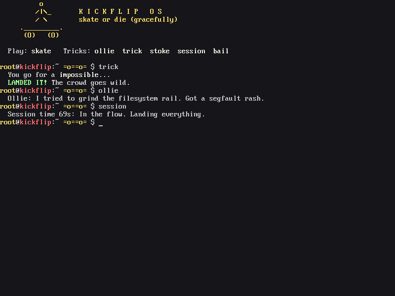
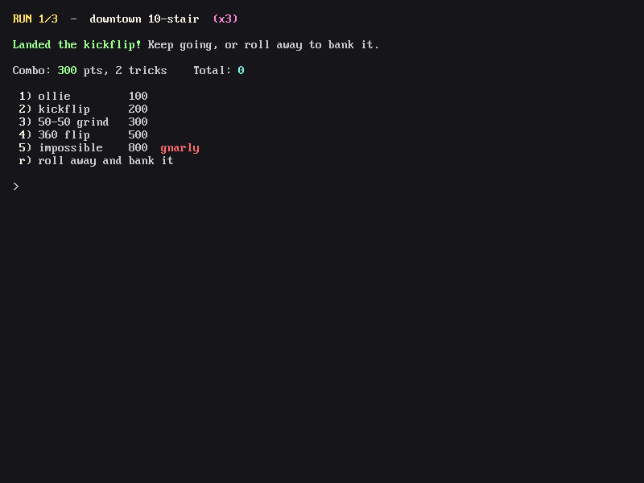

# KickflipOS

A tiny skateboard-themed Linux OS that runs in VirtualBox. It's the Linux kernel, BusyBox and a
handful of scripts with attitude. Your guide is **Ollie**, a skater who lives in the terminal.

## Build it (Ubuntu 24.04)

**1. Install the build tools** (one time only):

    sudo apt install git build-essential flex bison bc libelf-dev libssl-dev cpio xz-utils grub-pc-bin xorriso mtools console-setup-linux

**2. Get the code** (one time only):

    git clone https://github.com/samburwood23/kickflipOS.git
    cd kickflipOS

**3. Build:**

    ./build.sh

The first build downloads and compiles Linux and BusyBox from source, which takes a few minutes.
After that, rebuilding takes seconds. You get `kickflipos.iso` in the folder.

**4. Boot it in VirtualBox:** click **New**. **Name:** `KickflipOS`. **Type:** `Linux`.
**Version:** `Other Linux (64-bit)`. **Memory:** `512 MB`. **Hard Disk:** **Do Not Add a Virtual
Hard Disk** (the locker below adds one). Then attach the ISO as the VM's CD and click **Start**:

    VBoxManage storageattach KickflipOS --storagectl "IDE" --port 0 --device 0 --type dvddrive --medium ~/kickflipOS/kickflipos.iso

At the yellow menu, press Enter on **KickflipOS - drop in**. If the screen stays black, restart and
choose **old school (text mode)**.

**5. Test it (optional):** `sudo apt install qemu-system-x86`, then `python3 tests/smoke_test.py`
boots it three times and checks everything works, including the locker.

## Save your stuff: the locker

KickflipOS runs from RAM, so everything resets when you power off unless you give it a **locker**:
a small virtual disk that keeps `/root` (your high scores, files and shell history). With the VM
powered off:

    VBoxManage createmedium disk --filename ~/kickflipos-locker.vdi --size 64
    VBoxManage storageattach KickflipOS --storagectl "IDE" --port 1 --device 0 --type hdd --medium ~/kickflipos-locker.vdi

On the next boot you'll see `New locker set up`. Run `locker` inside KickflipOS to check it.
KickflipOS only ever formats a disk that is completely blank, so it won't wipe a disk with
anything on it.

## Commands inside KickflipOS

| Command | What it does |
|---|---|
| `skate` | Play **Street Session**, the turn-based combo game |
| `cruise` | Play **Street Cruise**, the real-time side-scroller |
| `locker` | Check whether your stuff is being saved |
| `hello` | Show the welcome screen |
| `ollie` | Ollie says something |
| `trick` (or `grind`) | Try a random trick: land it or bail |
| `stoke` | Random skate wisdom |
| `session` | How you're feeling, based on uptime |
| `skatecolors` | Reapply the skate colour palette |
| `cls` | Clear the screen and show the welcome screen |
| `ll` | List all files in detail |
| `bail` | Power off |

You also get ~300 standard commands from BusyBox (`ls`, `cd`, `cat`, `vi`, `top`, `ps`...). Type
`busybox --list` to see them all.

### Street Session rules

Each game is 3 runs at random spots. On each run, chain tricks to build a combo. Every extra trick
is harder to land, and if you bail, you lose the whole run. Roll away (`r`) to bank your points.
Your score is combo points x number of tricks x spot multiplier.

### Street Cruise rules

Cones roll towards you. Press **SPACE** (or **W**) to ollie over them. Press **K** while you're in
the air to kickflip for 25 bonus points. The street speeds up as your score climbs. **Q** quits.
Best scores are saved in your locker.

## Make changes

| To change... | Edit |
|---|---|
| Boot messages | `rootfs/init` |
| Welcome screen | `rootfs/bin/hello` |
| Ollie's lines, tricks, wisdom | `rootfs/etc/ollie.txt`, `tricks.txt`, `stoke.txt` (one per line) |
| Colours | `rootfs/bin/skatecolors` (hex values) |
| Prompt and aliases | `rootfs/etc/profile` |
| The games | `rootfs/bin/skate`, `rootfs/bin/cruise` |
| Kernel options | `config/kernel.fragment` |
| BusyBox options | `config/busybox.fragment` |
| Kernel/BusyBox versions | `versions.sh` |
| Boot menu | `iso/boot/grub/grub.cfg` |

After editing, run `./build.sh` again and restart the VM. To get changes made elsewhere (for example by Claude):

    git pull
    ./build.sh

## How it works

`build.sh` downloads exact, pinned versions of the Linux kernel and BusyBox (`versions.sh`) and
builds them from source. The kernel starts from `make tinyconfig`, the smallest possible
configuration, and adds only what KickflipOS needs (`config/kernel.fragment`). The result is about
2 MB, compared with about 15 MB for Ubuntu's kernel. BusyBox is built as a single static binary.

BusyBox and everything in `rootfs/` are packed into a compressed archive (the *initramfs*), which
`grub-mkrescue` wraps with the kernel and the GRUB boot menu into a bootable ISO. When the VM boots,
the kernel unpacks the initramfs into RAM and runs `rootfs/init`, which is the start of KickflipOS.
If a locker disk is attached, `init` mounts it at `/root`.

Every push to GitHub builds the ISO and boot-tests it in QEMU (`.github/workflows/build.yml`).
See `THIRD-PARTY-NOTICES.md` for the licences of the software KickflipOS is built from.
